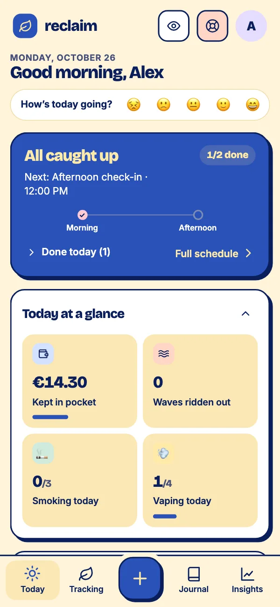
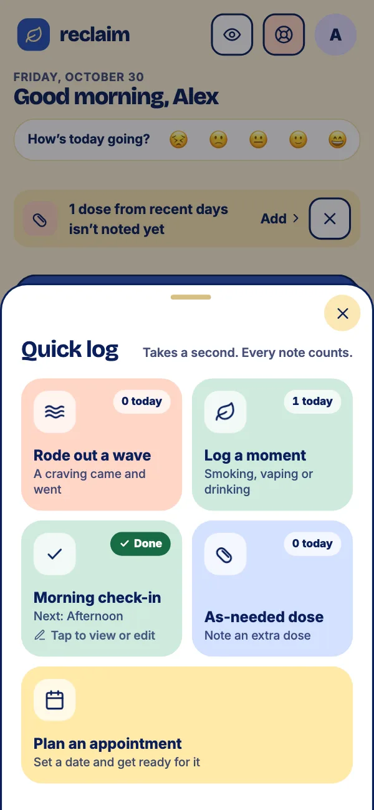
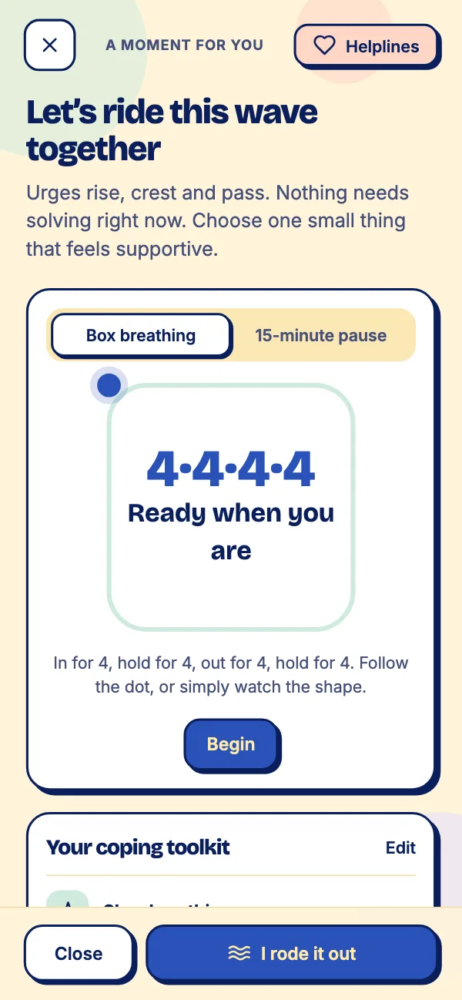
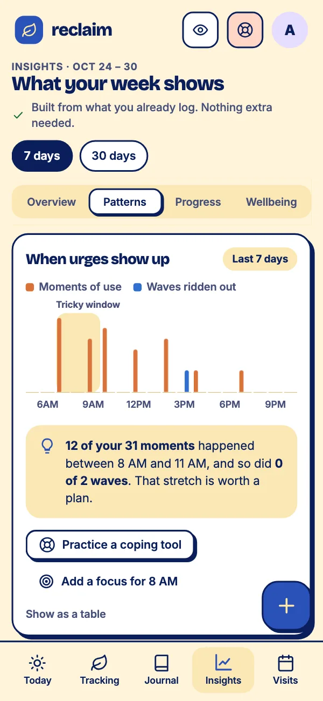
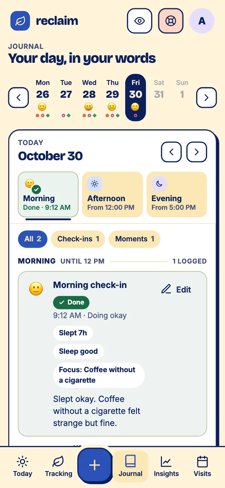
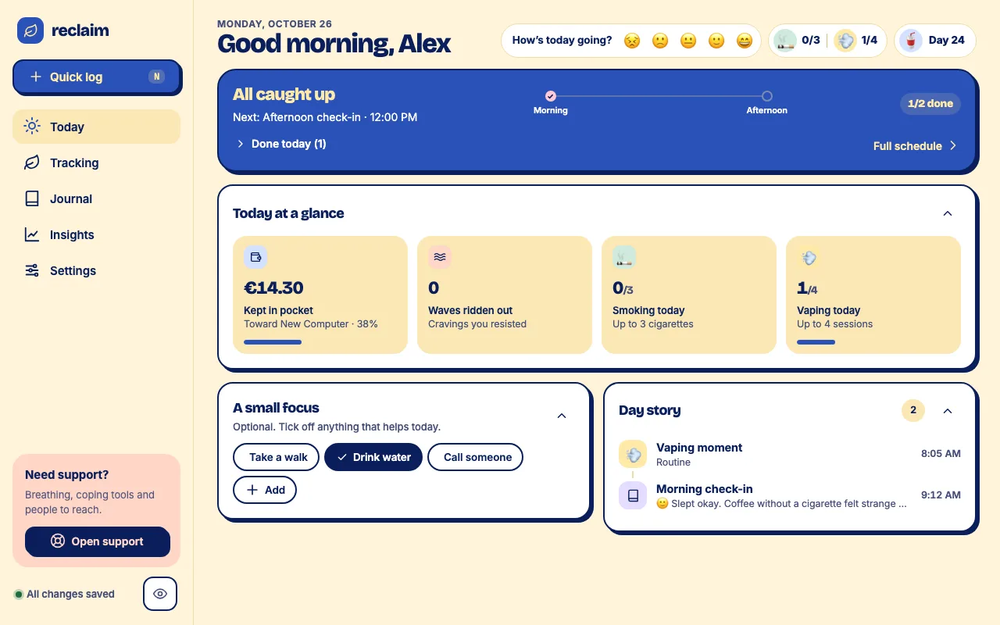

<div align="center">


# Reclaim

**Change at your own pace.**<br>
A free, calm companion for quitting, cutting back or just keeping track of<br>
smoking, vaping, drinking and medication.

<a href="https://reclaim.day"></a>

<a href="https://github.com/chrisglaske/reclaim.day/actions/workflows/live.yml"></a>

[What's new](https://reclaim.day/whats-new/) · [FAQ](https://reclaim.day/faq/) · [Privacy](https://reclaim.day/privacy/)

<br>







</div>

<br>

## ✨ What it does

| | |
|---|---|
| ☀️ **Check in when it suits you** | One calm screen for what's next. Morning, afternoon and evening check-ins, all optional. |
| ⚡ **Log in a tap** | A cigarette, a vape, a drink, a dose or a craving. Every note counts; none is a mark against you. |
| 🌬️ **Ride out the urge** | Slow breathing and a 15-minute pause. Most urges pass; this helps you wait. |
| 💊 **Your doses, on your to-do** | Tick them off, mark one as taken earlier, or skip it today. No nagging, no notifications. |
| 📈 **Spot your tricky hours** | See when urges show up, then plan for them. |
| 💰 **See what you've kept** | Money not spent, and progress toward something you want. |
| 📓 **Write it down, or don't** | A private journal for the days that need more than a tap. |
| 🩺 **Ready for your appointment** | A summary of a chosen period, the way a clinician asks, to copy or print. |
| 🎨 **Pick your colors** | Five looks, including a dark one for late nights. |

You choose the goal for each habit: **quit**, **cut back**, or **just track**, which never uses over/under language. No grades, no guilt.

## 🔒 Your data stays yours

<table>
<tr>
<td width="60%">

Reclaim has **no server**. The page talks to the Google Drive API straight from your browser, with the narrow `drive.file` scope, so it can only see the files it created, nothing else in your Drive.

Everything you log is one JSON file in a `Reclaim` folder in **your own Drive**, with backups next to it. Nobody else, including me, ever sees it.

🚫 No ads &nbsp;·&nbsp; 👀 No trackers or analytics &nbsp;·&nbsp; 🔕 No notifications &nbsp;·&nbsp; 🗑️ Delete it any time

This repository is public so you can check all of that for yourself: [`storage-drive.html`](app/scripts/storage-drive.html) is every call the app makes to Drive, and [`signin.html`](app/scripts/signin.html) the Google sign-in. [How Reclaim works](ARCHITECTURE.md) walks through it, with the format of your data file.

**The live app is this code.** The build is reproducible, so building this repository gives exactly the files app.reclaim.day serves. A [check](https://github.com/chrisglaske/reclaim.day/actions/workflows/live.yml) compares them byte for byte on every change and once a day, and you can run it yourself: `node tools/build-app.mjs && node tools/verify-live.mjs`.

</td>
<td>

```
My Drive
└── 📁 Reclaim
    ├── 📁 Live Data
    │   └── 📄 Reclaim Live Data.json  🔒
    └── 📁 Backups
```

</td>
</tr>
</table>

## 🖥️ Phone or big screen

<div align="center">

</div>

Works in any modern browser. Add it to your home screen (or install it from Chrome or Edge) and it opens like any other app.

## 🛠️ How it's built

Plain HTML, CSS and JavaScript: no frameworks, no CDNs, self-hosted fonts. One small build step inlines the app into a single page. [How Reclaim works](ARCHITECTURE.md) explains the pieces and the data format.

| Folder | What's in it |
|---|---|
| [`app/`](app) | The app. `Index.html` stitches in `styles/` and `scripts/` in load order: the data layer (`state`, `core`, `habits`, `meds`, `journal`, `insights`, …, read through `model`), then the screens (`ui-today`, `ui-tracking`, `ui-journal`, `ui-insights`, `ui-settings`, …), then `start`. `icons/` and `fonts/` hold the self-hosted icons and fonts. |
| [`app-host/`](app-host) | app.reclaim.day: a Cloudflare Worker that only serves the built static files. |
| [`site/`](site) | The website, reclaim.day: the landing page, [What's new](site/whats-new), the [FAQ](site/faq), [guides](site/guides) and the [privacy policy](site/privacy). A small Vite project, also served as static files by a Cloudflare Worker. The screenshots are real captures of the app on made-up sample data. |
| [`tools/`](tools) | [`build-app.mjs`](tools/build-app.mjs), the build step that turns `app/` into the page app.reclaim.day serves, and [`verify-live.mjs`](tools/verify-live.mjs), which checks the live app against it. |

## 🚀 Build it

You need Node.js.

```sh
node tools/build-app.mjs                  # the app, built into dist/app
cd site && npm install && npm run dev     # the website at http://localhost:5173/
```

The Google OAuth Client ID in `tools/build-app.mjs` only works on app.reclaim.day. To host your own copy, create a Google Cloud OAuth client with the `drive.file` scope and use its ID.

## 💬 Ideas, bugs and contributions

Ideas and bug reports are very welcome: [open an issue](../../issues) or write to [contact@reclaim.day](mailto:contact@reclaim.day). Pull requests are welcome too.

## 📄 License

Reclaim is open source under the [GNU Affero General Public License v3.0](LICENSE). You may use, study, change and share it. If you share a changed version, or run one for other people over a network, you must make its full source available under the same license.

The name **Reclaim**, the Reclaim logo, the website's text and the screenshots are not covered by this license. If you publish your own version, please give it a different name, icon and wording so people don't mistake it for this one. The fonts in `app/fonts/` keep their own SIL Open Font License.

> **A personal request, not a legal term:** I made Reclaim free so that people trying to change a habit don't have to pay for help. Please don't sell copies of it.

## ⚕️ Not medical advice

Reclaim is a tracking tool, not medical advice. Talk to a doctor or pharmacist before changing your medication, and before stopping alcohol suddenly if you drink heavily, because withdrawal can be dangerous. If you're in crisis, call or text **988** in the US, call **112** in the EU, or see [findahelpline.com](https://findahelpline.com).

<br>

<div align="center">

💛 If Reclaim helps you, you can [support it on Ko-fi](https://ko-fi.com/S5P629GQ84).

Made by [Chris Glaske](https://glaske.co)

</div>
